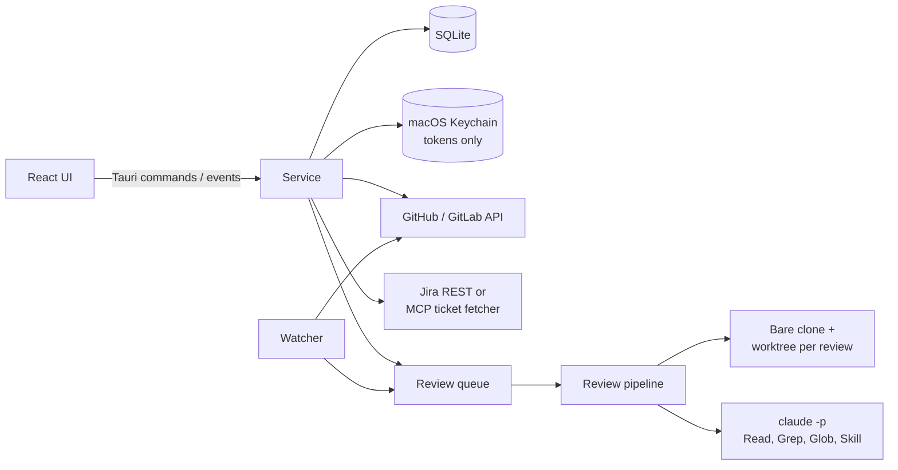
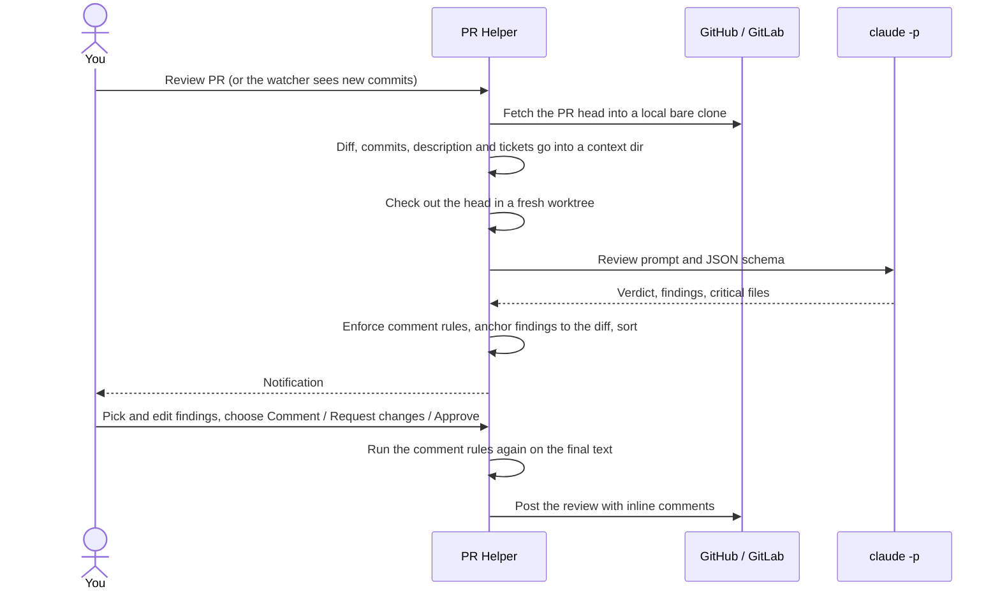
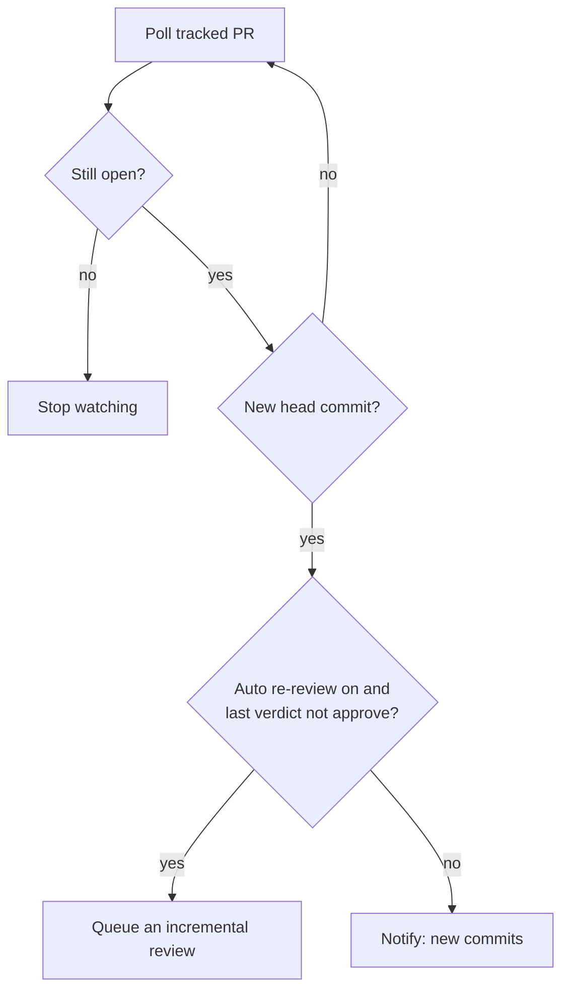

# PR Helper

A macOS menu bar app that reviews pull requests on GitHub, GitHub Enterprise, GitLab.com and self-managed GitLab with a read-only, headless [Claude Code](https://claude.com/claude-code) session. Nothing is posted until you pick it.

## Features

- **One inbox for every server.** Connect several servers and see every open PR/MR your account can see, filtered by review requested, involved, authored or all.
- **Local, locked-down reviews.** The PR is checked out locally, and Claude reviews it with only Read, Grep, Glob and Skill. It has no shell, no write access, and ignores the PR's own Claude settings and MCP servers.
- **Findings you control.**
  - Findings are sorted by severity, and each has an explanation, diff context and a proposed comment you can edit.
  - You choose which comments to post, then Comment, Request changes or Approve.
  - A comment that can't be anchored inline goes into the review body instead.
- **Critical files.** The reviewer names up to five files worth reading yourself. You can read them with syntax highlighting, add your own comments, and optionally have Claude check a comment before you post it.
- **Linked Jira tickets.** Ticket keys from allowed projects are found in the branch, title or description. The tickets are given to the reviewer as context, loaded over the Jira REST API or through an MCP server in your Claude Code. An optional scope check reports requirements the PR misses.
- **Comment rules enforced in code.**
  - No double dashes or em/en dashes in prose.
  - No AI attribution, unless you allow it.
  - Nits can be skipped.
  - An approve verdict with a medium-or-higher finding is downgraded.
- **Settings per server and per repository**, overriding the global defaults: comment language, skip nits, auto re-review on new commits, auto-approve on an approve verdict, model, effort, budget, and ticket source.
- **Custom review skills.** Point at a folder with a `SKILL.md`, or write one in the app.
- **Watching.** Reviewed PRs are polled for new commits. You get a notification, and optionally an incremental re-review. Auto-approval is skipped when the PR text tries to steer the reviewer.

## How it works



A review, from start to posted comments:



Watching a reviewed PR:



Everything from the PR (title, description, commits, diff) and from tickets is treated as untrusted data. API tokens live only in the Keychain. Git gets them through per-process environment variables, never in a URL or on disk.

## Install

```sh
brew install --cask joessst-dev/tap/pr-helper
```

The app is ad-hoc signed, not notarized (no Apple Developer ID). The cask clears the quarantine flag so Gatekeeper lets it open. Because the ad-hoc signature changes with every build, macOS may ask after an upgrade whether PR Helper may access its Keychain items; choose "Always Allow". `brew uninstall --zap` removes app data but not the tokens in the Keychain.

## Requirements

- [Claude Code](https://claude.com/claude-code), logged in (`claude` on your PATH, or set its path in Settings)
- git
- Rust (stable) and Node 20+ to build from source

## Tokens

- **GitHub:** a classic PAT with `repo` and `read:org`, or a fine-grained token with Pull requests (read/write) and Contents (read).
- **GitLab:** a PAT with the `api` scope. "All visible" needs a group scope in the server settings.
- **Jira Cloud:** your account email and an API token. **Jira Server / Data Center:** a personal access token. An MCP ticket source needs no token in the app.

## Development

```sh
npm install
npm run tauri dev     # run the app
npm run check         # typecheck, frontend tests, rustfmt, clippy, Rust tests
npm run tauri build   # build the .app / .dmg
```

`cd src-tauri && cargo test real_claude -- --ignored --nocapture` runs a review end to end with the real `claude` CLI (haiku, costs a few cents).

## Releasing

1. Bump the version in `src-tauri/tauri.conf.json`, `src-tauri/Cargo.toml` and `package.json` (they must match), merge it to `main`.
2. Tag and push: `git tag vX.Y.Z && git push origin vX.Y.Z`.

`.github/workflows/release.yml` builds a universal `.dmg`, publishes a GitHub Release and updates `Casks/pr-helper.rb` in [Joessst-Dev/homebrew-tap](https://github.com/Joessst-Dev/homebrew-tap). Tags with a `-` (e.g. `v0.2.0-rc1`) become prereleases and skip the tap. Running the workflow by hand only builds (dry run).

The tap push needs the repo secret `HOMEBREW_TAP_TOKEN`: a fine-grained PAT with Contents read/write on `homebrew-tap` only.

## License

[MIT](LICENSE)
